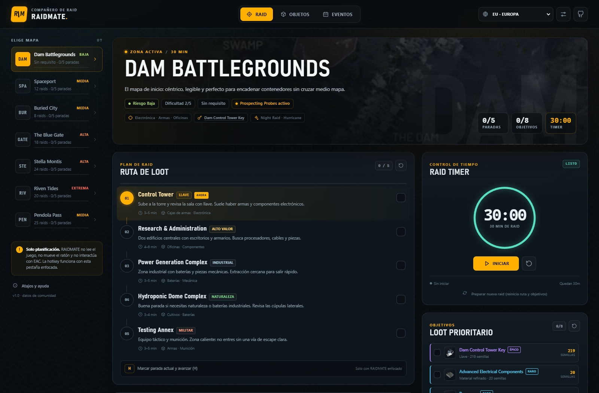
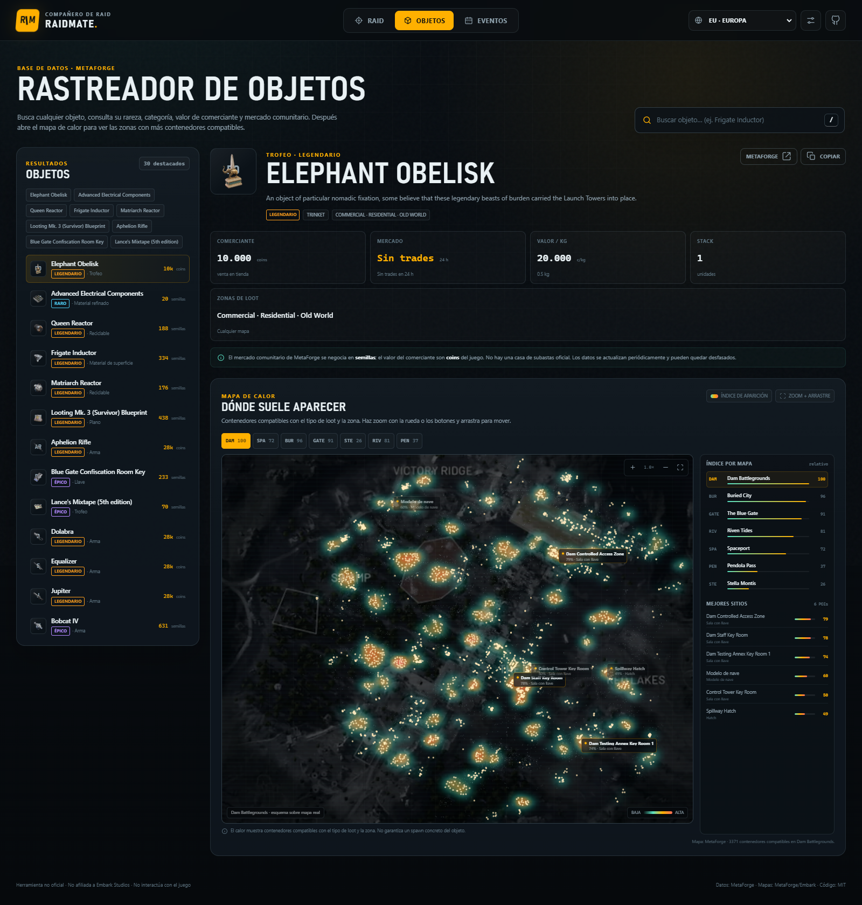
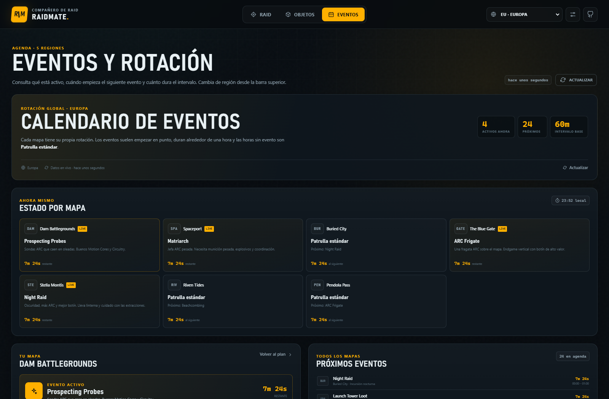

# RAIDMATE

**Compañero de raid open-source para ARC Raiders.** Rutas de loot, timer, eventos por región, mercado comunitario y mapas de calor con zoom.

[](LICENSE)
[](https://joseestebanmarinrincones-dot.github.io/raidmate-arc-raiders/)
[](#qué-no-es)



> Herramienta fan no oficial. No afiliada a Embark Studios. **No interactúa con el juego, no lee memoria, no mueve el ratón y no envía entradas a ARC Raiders.**

---

## Qué hace

- **Planificador de raid** con los 7 mapas actuales: Dam Battlegrounds, Spaceport, Buried City, The Blue Gate, Stella Montis, Riven Tides y Pendola Pass.
- **Rutas de loot** por mapa con paradas ordenadas, progreso y notas persistentes.
- **Timer de 30 minutos** con estados de aviso, pausa y reinicio de raid.
- **Hotkey configurable**: cualquier tecla útil del teclado, no solo `H`. Se puede cambiar desde Configuración.
- **Eventos por región**: EU, NA, SA, Asia y Oceanía. Muestra qué está activo, cuándo empieza el siguiente, cuánto dura y el intervalo entre eventos de cada mapa.
- **Base de datos de objetos** con nombre, rareza, categoría, peso, stack, zonas de loot y valor.
- **Valor de comerciante en coins** y **referencia de mercado comunitario en semillas** (MetaForge Marketplace).
- **Mapa de calor interactivo** por objeto y mapa. Zoom con rueda, botones o pellizco; arrastre para mover; ranking de mapas y mejores sitios.
- **Funciona como web app** en GitHub Pages y también en local con un servidor Python incluido.
- **Datos actualizados**: los eventos se refrescan cada hora mediante GitHub Actions; la versión web siempre usa la última versión publicada.





---

## Inicio rápido

### Opción A — Web (recomendada, siempre actualizada)

Abre:

**https://joseestebanmarinrincones-dot.github.io/raidmate-arc-raiders/**

No requiere instalación. Funciona en escritorio y móvil. Si la instalas como PWA desde el navegador, tendrás acceso directo.

### Opción B — Local en Windows

1. Instala [Python 3.10+](https://www.python.org/downloads/) y marca “Add Python to PATH”.
2. Descarga el repositorio o clona:
   ```powershell
   git clone https://github.com/joseestebanmarinrincones-dot/raidmate-arc-raiders.git
   cd raidmate-arc-raiders
   ```
3. Ejecuta:
   ```text
   start.bat
   ```
4. Se abrirá `http://127.0.0.1:8765/`.

El servidor local añade dos cosas que la versión estática no puede hacer por CORS:

- eventos en vivo desde MetaForge (`/api/events`);
- consulta de mercado bajo demanda para cualquier objeto (`/api/market`).

### Opción C — Local en Linux/macOS

```bash
python3 server.py --open
```

También puedes servir la carpeta con cualquier servidor estático. La app necesita un servidor HTTP porque carga datos JSON; abrir `index.html` con doble clic no funciona.

---

## Cómo se usa

### Raid

1. Elige un mapa en la columna izquierda.
2. Sigue la ruta. Pulsa la hotkey configurada (por defecto `H`) para marcar la parada actual y avanzar.
3. Marca los objetivos de loot que ya llevas.
4. Inicia el timer de 30 minutos.
5. Consulta el panel de eventos para saber qué condición hay ahora y cuál viene después.
6. Guarda notas por mapa: llaves, rutas alternativas, objetivos de misión.

### Objetos

1. Abre **Objetos**.
2. Busca por nombre (`Frigate Inductor`, `Queen Reactor`, `Elephant Obelisk`…) o por tipo/rareza.
3. Revisa comerciante, mercado comunitario, valor por kg, categoría y zonas.
4. El **mapa de calor** muestra los contenedores compatibles con ese tipo de loot. Cambia de mapa con las pestañas, haz zoom y arrastra.
5. El panel derecho ordena los mapas por índice relativo y muestra los POIs con más calor.

### Eventos

1. Abre **Eventos**.
2. Cambia la región en la barra superior o en Configuración.
3. Consulta el estado por mapa, los próximos eventos y la tabla de rotación con el intervalo hasta el siguiente evento.
4. Los eventos suelen empezar en punto, duran alrededor de 60 minutos y las horas sin evento son **Patrulla estándar**.

### Configuración

- **Hotkey**: haz clic en el recuadro y pulsa la tecla que quieras. `Esc` cancela; `Tab` y los modificadores puros están reservados.
- **Región**: EU, NA, SA, Asia, Oceanía.
- **Actualizar eventos**: fuerza una consulta (en local) o recarga los datos (en web).
- **Borrar datos locales**: elimina ruta, notas, timer, hotkey y objetivos de este navegador. No afecta a tu cuenta del juego.

---

## Atajos de teclado

| Tecla | Acción |
| --- | --- |
| `H` (configurable) | Marcar parada activa y avanzar |
| `/` | Ir a la búsqueda de objetos |
| `1`–`7` | Cambiar de mapa |
| `Espacio` | Iniciar/pausar el timer |
| `?` | Abrir atajos |
| `Esc` | Cerrar ventanas |

> Los atajos funcionan solo cuando **RAIDMATE tiene el foco**. No hay hook global de teclado, no se inyectan entradas y no se envía nada al juego. Si ARC Raiders está en primer plano, la tecla pertenece al juego.

---

## Actualizaciones

### Versión web

GitHub Pages sirve siempre el último `main`. No tienes que hacer nada: al recargar recibes la última versión. Los datos de eventos se actualizan cada hora con un workflow; el mercado se refresca periódicamente.

### Copia local

Si clonaste con Git:

```powershell
git pull --ff-only
```

Si descargaste un ZIP, ejecuta:

```powershell
.\update.ps1
```

El script descarga la última versión de `main`, la extrae y copia los archivos de la app. Tu progreso (ruta, notas, timer, hotkey) vive en `localStorage` del navegador, así que no se pierde al actualizar los archivos. Cierra el servidor antes de actualizar.

También puedes descargar la última versión desde [Releases](https://github.com/joseestebanmarinrincones-dot/raidmate-arc-raiders/releases).

---

## Qué no es

- **No es un auto-looter ni un cheat.** No lee la pantalla, no mueve el ratón, no pulsa teclas en el juego, no se conecta a EAC y no intenta evadir anti-cheat.
- **No es una app oficial.** Es un proyecto fan. Los datos pueden contener errores o quedar desfasados tras un parche.
- **No garantiza spawns.** El heatmap es una estimación espacial basada en contenedores compatibles con el tipo de loot. No es telemetría de spawns ni una bola de cristal.
- **No hay casa de subastas oficial.** El “mercado” que se muestra es la referencia comunitaria de MetaForge en semillas; el valor de comerciante son coins del juego.

---

## Datos y metodología

### Fuentes

- [MetaForge ARC Raiders API](https://metaforge.app/arc-raiders/api) para objetos, valores, rarezas, mapas, marcadores y calendario de eventos.
- [MetaForge Marketplace](https://metaforge.app/arc-raiders/market/insights) para la mediana comunitaria de 24 h en semillas.
- Mapas e imágenes de MetaForge / Embark Studios. Ver [NOTICE.md](NOTICE.md).
- Los datos de rutas, consejos y selección de POIs son curación propia del proyecto.

### Heatmap

Cada mapa tiene marcadores reales de contenedores, naturaleza, ARC y eventos, con sus coordenadas. La app:

1. Deriva las áreas de loot del objeto (por ejemplo, `Electrical`, `Residential`, `ARC`).
2. Filtra los marcadores compatibles con esas áreas.
3. Pondera el tipo de contenedor (caja de armas, locker, alijo, etc.).
4. Pinta una cuadrícula de densidad y ordena los POIs cercanos.

Por eso el calor indica **dónde hay más contenedores compatibles**, no “aquí ha spawnado este objeto”. Es una herramienta de planificación, no una promesa.

### Mercado

- **Comerciante**: valor de venta del objeto en coins, tomado del catálogo de MetaForge.
- **Mercado**: mediana de 24 h de MetaForge Marketplace en **semillas**. Si no hay trades, aparece `Sin trades`.
- Los datos se guardan en `data/market.json` y se actualizan periódicamente.
- En local, el servidor puede consultar el mercado de un objeto concreto bajo demanda.

---

## Estructura del proyecto

```text
.
├── index.html                 # Shell de la app
├── styles.css                 # Diseño y responsive
├── js/
│   ├── app.js                 # Estado, vistas, timer, eventos, mercado
│   ├── heatmap.js             # Heatmap canvas, zoom y pan
│   ├── events.js              # Normalización y cálculos de eventos
│   └── icons.js               # Iconos SVG inline
├── data/
│   ├── items.json             # Catálogo compacto de objetos
│   ├── maps/*.json            # Marcadores y POIs por mapa
│   ├── events/*.json          # Calendario por región
│   ├── market.json            # Snapshot de mercado
│   └── meta.json              # Metadatos de la build
├── assets/
│   ├── maps/*.webp            # Mapas (ver NOTICE.md)
│   └── icons/                 # Iconos PWA
├── scripts/build_data.py      # Genera los datos desde MetaForge
├── server.py                  # Servidor local + proxy live
├── start.bat                  # Lanzador Windows
├── update.ps1                 # Actualizador para copia local
└── .github/workflows/         # Pages y refresco de datos
```

### Regenerar datos

```bash
python scripts/build_data.py --skip-market
python scripts/build_data.py --market-only --market-limit 150
python scripts/build_data.py --events-only
```

Requiere Python 3.10+ y Pillow (`pip install pillow`) para convertir los mapas a WebP. Los datos crudos se cachean en `data/raw/` (ignorado por Git).

---

## Contribuir

Las contribuciones son bienvenidas. Antes de abrir un PR:

1. Mantén el enfoque **sin interacción con el juego**.
2. No añadas hooks globales, lectura de memoria, inyección de input ni automatización de ARC Raiders.
3. Si cambias datos de mapas u objetos, indica la fuente y la fecha.
4. Prueba en escritorio y móvil.
5. Ejecuta `node --check js/app.js`, `node --check js/heatmap.js` y `python -m py_compile server.py scripts/build_data.py`.

Abre un issue con:
- mapa/objeto afectado;
- qué esperabas;
- qué ocurrió;
- captura o enlace si es posible.

---

## Créditos

- **Embark Studios** por ARC Raiders y sus mapas.
- **MetaForge** por la API y el marketplace comunitario.
- **Comunidad de ARC Raiders** por los datos, correcciones y feedback.
- **Iconos**: SVG propios inspirados en el lenguaje visual del juego.
- **Código**: MIT. Los assets de mapa y datos de terceros tienen sus propias condiciones; ver [NOTICE.md](NOTICE.md).

---

## Licencia

Código bajo [MIT](LICENSE). No se concede ninguna licencia sobre marcas, mapas, imágenes o datos de terceros. ARC Raiders y EMBARK son marcas de Embark Studios AB.
